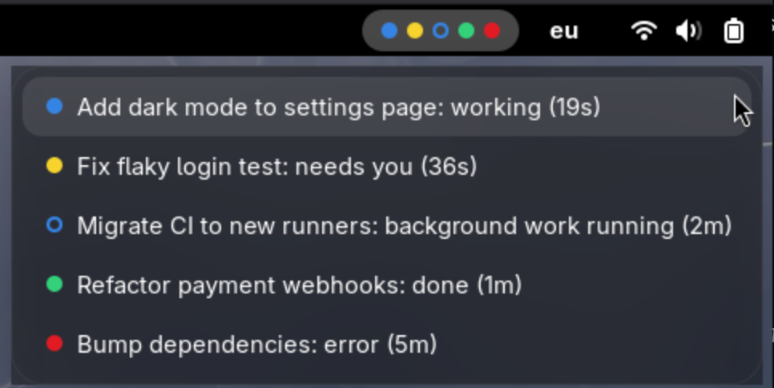

# Claude Lights

A GNOME Shell extension that shows one light in the top bar for every running
[Claude Code](https://code.claude.com) session, so you can see at a glance
which sessions are waiting for you.



| Light | Meaning |
|---|---|
|  Blue | Working |
|  Yellow | Needs you: permission prompt, question or plan approval |
|  Green ring | Claude replied, background commands or agents are still running |
|  Blue ring | Background work still running, and you have seen the last reply |
|  Green | Done, waiting for your next prompt |
|  Red | Turn ended with an API error |

Yellow, green, the green ring and red pulse until you have seen them: focus
that session's terminal window, jump to it from the menu or send it a message.
A seen green ring turns into a blue ring. A light that changes to a new state
pulses again. Blue lights never pulse, they're work in progress.

Lights keep their position (ordered by session start; drag them by the
grip in the menu) and disappear when the session ends. Click them for a list with each session's title (the same one
your terminal shows, or the name set with `/rename`), state and time in that
state. Click a session to jump to its terminal window.

## How it works

A Claude Code [hook](https://code.claude.com/docs/en/hooks) runs on session,
prompt, tool, permission and stop events and writes one small JSON file per
session to `$XDG_RUNTIME_DIR/claude-lights/`. The extension watches that
directory and draws the lights. Sessions whose Claude process is gone are
removed automatically.

Nothing leaves your machine: no network access, no telemetry. The state files
hold only the session's state, title, working directory, process ID and
timestamps,
and live in your private runtime directory (cleared on logout).

## Requirements

- GNOME Shell 45 or newer (tested on 48)
- Claude Code with hooks support
- `python3`

## Install

```sh
git clone https://github.com/ohgeebtw/claude-lights.git
cd claude-lights
./install.sh
```

The installer:

1. copies the hook to `~/.local/share/claude-lights/`
2. adds hook entries to `~/.claude/settings.json` (or `$CLAUDE_CONFIG_DIR`),
   keeping your existing hooks and writing a `settings.json.claude-lights.bak`
   backup first
3. copies the extension to `~/.local/share/gnome-shell/extensions/` and enables it

On Wayland, GNOME loads new extensions only at login: log out and back in once.
Running Claude sessions pick up the hooks immediately.

Re-run `./install.sh` to update.

## Uninstall

```sh
./uninstall.sh
```

Removes the extension, the hook entries (other hooks stay untouched), the hook
script and the state files.

## Development

GNOME on Wayland loads extension code only at login. To try changes without
logging out:

```sh
tools/nested.sh
```

This opens a nested GNOME Shell window with the current extension code, demo
sessions in every state and two terminals to test jumping to a window. Close
the window, edit, run it again.

`tools/demo.sh` shows the same demo sessions in your real top bar (your real
sessions are hidden until you stop it with Ctrl+C), for example for
screenshots.

## Known limitations

- Interrupting Claude with Esc may not fire a stop event. The light stays blue
  until Claude's idle notification turns it green (about a minute).
- Only sessions started on this machine under your user are shown.
- Jumping to a terminal matches the window title, so it can't reach a session
  in a background tab, and picks the first window when two sessions share a
  title.

## License

[MIT](LICENSE)
